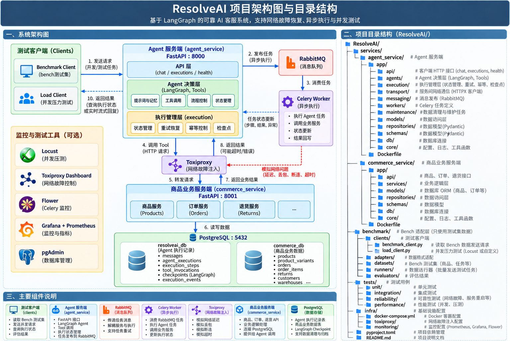
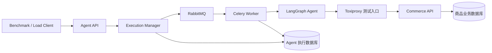

# ResolveAI 架构说明

> 依据：[项目架构图与目录结构](./60ca69ff-446b-492f-9059-bcb2d1fbbede.png)。图片描述的是目标架构；本文同时标明仓库当前实现，避免将规划组件误认为已经部署。

## 1. 系统边界

目标系统分为测试客户端、Agent 服务、异步执行设施、商品业务服务和数据存储五部分。Benchmark Client 发送评测任务，Load Client 发送并发请求；两者都通过 Agent Service 的 HTTP API 进入系统。Agent Service 负责会话、决策、任务生命周期和结果查询。Commerce Service 独立负责商品、用户、订单、退换货等业务规则与事务。

[打开可交互的目标架构图](../.archify/architecture-resolveai-target-20261015-214023/resolveai-v2-checked.html)。该图按图片中的目标关系重绘；图稿校验、交付和生成文件一致性检查已通过，浏览器自动检查受当前环境限制，尚未通过。

| 组件 | 目标职责 | 当前工作区状态 |
| --- | --- | --- |
| Agent Service（FastAPI :8000） | `/chat`、`/executions`、`/health`；LangGraph 决策与工具编排；执行状态管理 | 尚未建立 `services/agent_service/` |
| RabbitMQ 与 Celery Worker | 持久任务投递、异步消费、重试和结果回写 | 尚未接入 |
| Toxiproxy | 在 Agent 工具调用与 Commerce HTTP 服务之间注入延迟、断连、丢包和超时 | 尚未接入 |
| Commerce Service（目标 :8001） | 商品、客户、订单及退换货 HTTP API，承接业务写操作 | 已有 FastAPI、零售 ORM、Repository、Service 和路由；端口由启动命令决定，当前 README 默认 8000 |
| PostgreSQL | 目标上分离 Agent 执行数据与商品业务数据 | 当前使用单个 `resolveai` 数据库，已建立 12 张零售表并导入 `benchmark/datasets/db.json` |
| Benchmark 数据与 runner | 提供商品测试数据、任务定义和导入入口 | 已有 `db.json`、`tasks.json`、`split_tasks.json` 和 JSON 导入 runner；图片中的压测客户端尚未实现 |
| 可选观测工具 | Locust、Flower、Prometheus/Grafana、pgAdmin 与 Toxiproxy Dashboard | 图片中的规划组件，仓库当前没有对应配置 |

## 2. 目标请求链路

1. Benchmark Client 或 Load Client 向 Agent API 提交请求。API 校验输入，创建 execution 与首条消息，返回可追踪的 `execution_id`。
2. Execution Manager 持久化状态并将任务发布到 RabbitMQ。Celery Worker 消费任务，运行 LangGraph Agent；Agent 使用提示词、会话上下文、工具和流程状态生成下一步动作。
3. 需要商品业务数据时，工具通过 HTTP 访问 Commerce Service。测试环境可将这条 HTTP 链路经 Toxiproxy 转发，以注入网络故障。Agent 不直接修改 Commerce 数据库。
4. Commerce Service 经 Repository 和事务访问业务表，返回商品或订单结果。Worker 记录工具调用、执行事件及检查点，推进 execution 状态；客户端按 execution ID 查询状态、结果或事件流。
5. 遇到超时、断连或部分成功时，Execution Manager 根据错误类别决定重试、查询业务结果、等待人工处理或终止。对有副作用的工具调用必须使用幂等键或先核对结果，避免重试造成重复改价、退款或退换货请求。

目标主路径：

## 3. 服务与数据归属

**Agent Service** 拥有对话、执行状态、工具调用记录、执行事件和检查点。API 层只处理协议、校验和状态查询；决策层封装 LangGraph、提示词和工具；Execution Manager 统一控制排队、运行、重试、超时和终态；Worker 执行耗时任务。图片中的 `transport/` 负责外部 HTTP 调用，`messaging/` 负责队列发布，`maintenance/` 负责清理与维护任务。

**Commerce Service** 拥有商品、规格、用户、付款方式、订单及售后数据。Agent 的 Commerce Tool 只能调用其公开 HTTP API；业务规则、数据库事务及价格结算仍由 Commerce Service 决定。当前实现可见 `services/commerce_service/app/`，业务模型位于 `models/retail.py`，JSON 数据导入入口位于 `benchmark/runners/import_retail_json.py`。

**目标数据库隔离** 是同一 PostgreSQL 实例中的两个逻辑数据库：Agent 执行数据与 Commerce 业务数据分别迁移、授权和备份。现有 `resolveai` 数据库属于当前阶段；引入独立库时需要明确迁移与连接配置，不能仅修改数据库名称。

## 4. 目录规划与当前差距

图片中的目标目录以 `services/agent_service/app/` 为核心，包含 `api/`、`agents/`、`execution/`、`transport/`、`messaging/`、`workers/`、`maintenance/`、`models/`、`repositories/`、`schemas/`、`db/`、`core/`。`benchmark/clients/`、`adapters/`、`datasets/`、`runners/`、`evaluators/` 对应测试输入、适配、运行和评估。`infra/` 对应容器、故障注入和监控配置。

当前仓库已实现 Commerce 与部分 Benchmark 目录；Agent、队列、Worker、故障注入和监控仍是 V2 目标。实施顺序、接口契约、可靠性规则与验收标准见 [V2 开发规格](./spec_v2.md)。
